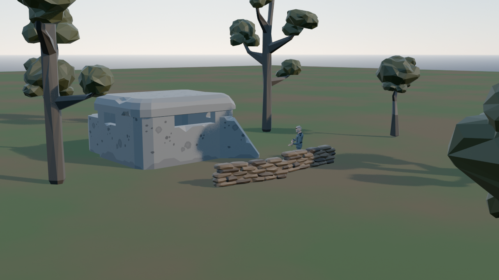
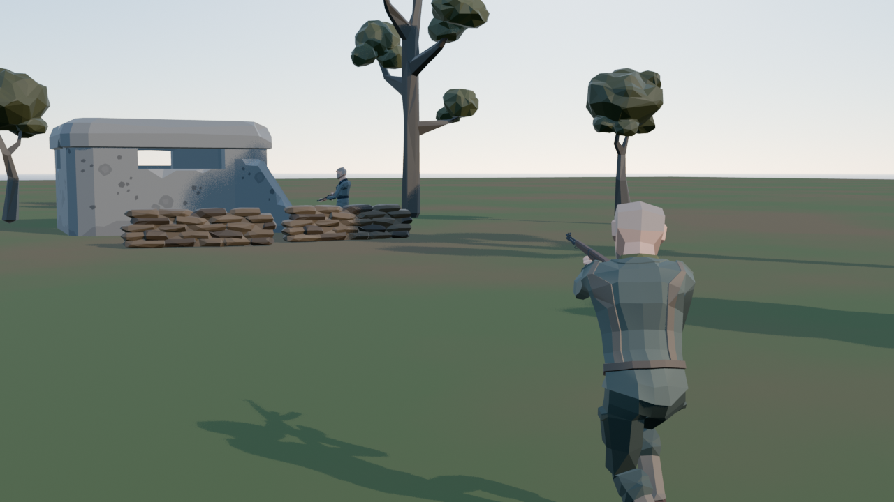
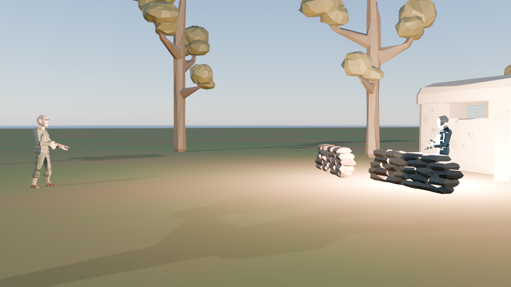

# Videos

Productions made with SlopStudio. Each video was made end to end by the pipeline: a script, actors and props cast from assets the platform built and published, a scene and a timeline, a Blender render and an MP4 encode. Newest cut first.

## Ranger: the drop

An American paratrooper runs in on a German bunker. The guard by the sandbags turns, and the Ranger throws a grenade.

### Cut 1 (2026-10-23): first end-to-end render

<video controls width="960" src="videos/ranger-the-drop/cut1.mp4"></video>

[Download the MP4](videos/ranger-the-drop/cut1.mp4) · 17.5 s · 3 shots · 1280×720 at 24 fps · Blender EEVEE

| Shot 1: establishing | Shot 2: the run in | Shot 3: the throw |
|---|---|---|
|  |  |  |

What it proves: script → casting (9 platform-built assets, fetched by version) → scene and timeline → Blender scene adapter in the sandboxed worker → MP4, with a record of every asset version and setting.

Rough edges: no throw or turn animation exists yet, so the throw is a posed arm and the guard's turn slides. The explosion is a simple flash. There is no voice.
